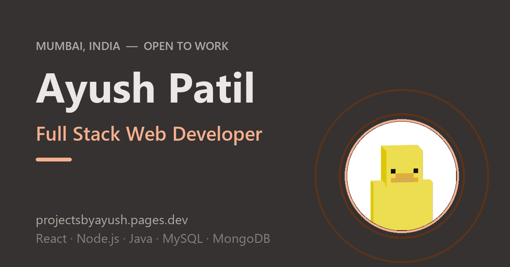

<div align="center">

# Ayush Patil — Portfolio

**Personal portfolio of Ayush Patil, Full Stack Web Developer from Mumbai, India.**

[Live Site](https://projectsbyayush.pages.dev/) · [Resume](https://projectsbyayush.pages.dev/resume) · [Email](mailto:projectsbyayush@gmail.com)


[](https://projectsbyayush.pages.dev/)

</div>

## About

A single-page portfolio built with **React 19**, **Vite 8** and **Tailwind CSS v4**, designed with **Material 3** (color roles, typescale, elevation, shape) — with full light/dark theming, accessible components and production-grade SEO.

Sections: **Work · About · Services · Stack · FAQ · Contact**, plus a bento-style hero with tech marquee, social strip, "based in" card and selected-work cards.

## Features

- **Material 3 design system** — oklch color tokens, M3 typescale, radius/elevation scales, state layers, built as reusable components
- **M3 components** — dialog, search bar, snackbar, tooltips, segmented buttons, text fields, chips, bottom sheet, FAB with scroll-progress ring
- **Light & dark themes** — segmented theme control, persisted in `localStorage`, respects `prefers-color-scheme`, no flash on load
- **Interactive work section** — project cards open an M3 dialog with details, tags and GitHub links; copy-link actions surface in a snackbar
- **Live stack search** — M3 search bar filters technologies across Frontend / Backend / Databases
- **FAQ accordion** — accessible `h3 > button` pattern with animated panels
- **Contact form** — M3 outlined text fields with floating labels + snackbar confirmation
- **SEO ready** — JSON-LD (`Person`, `WebSite`, `ProfilePage`, `FAQPage`, service catalog), Open Graph + Twitter cards, canonical, `robots.txt`, `sitemap.xml`, `<noscript>` fallback
- **Performance** — self-hosted fonts, 28-glyph subsetted Material Symbols icon font (~36 KB), zero runtime dependencies beyond React + Motion
- **Accessible** — semantic landmarks, keyboard-friendly components, ARIA states, reduced-motion support

## Built with

| Layer | Tech |
| --- | --- |
| UI | React 19, Motion |
| Build | Vite 8, Oxlint |
| Styling | Tailwind CSS v4, Material 3 tokens, `class-variance-authority` |
| Primitives | Radix UI (`Slot`), shadcn utilities |
| Fonts | Roboto Flex & Roboto Mono (self-hosted), subsetted Material Symbols Rounded |
| Icons | Custom SVG brand icons + Material Symbols subset |

## Getting started

```bash
npm install
npm run dev      # start dev server
npm run build    # production build → dist/
npm run preview  # preview the build locally
npm run lint     # oxlint
```

Deploy anywhere static — for Cloudflare Pages: build command `npm run build`, output directory `dist`.

## Project structure

```
src/
├── components/
│   ├── ui/            # M3 primitives: button, dialog, text-field, tooltip, snackbar
│   ├── hero.jsx       # bento hero, marquee, social strip, selected work + dialog
│   ├── about.jsx      # profile, stats, education
│   ├── services.jsx   # service cards
│   ├── stack.jsx      # searchable tech stack
│   ├── faq.jsx        # accordion
│   ├── contact.jsx    # form + socials
│   ├── site-header.jsx / site-footer.jsx
│   └── ...
├── lib/
│   ├── portfolio.js   # all site content in one place
│   ├── navigation.js  # nav destinations
│   ├── icon-codepoints.js
│   └── hooks.js       # theme, scroll, active section
├── assets/            # subsetted Material Symbols font
└── index.css          # M3 tokens, typescale, state layers
public/                # og image, favicon, robots.txt, sitemap.xml
```

All content lives in [`src/lib/portfolio.js`](src/lib/portfolio.js) — edit once, the whole site updates.

## Contact

- **Email** — [projectsbyayush@gmail.com](mailto:projectsbyayush@gmail.com)
- **LinkedIn** — [in/projectsbyayush](https://linkedin.com/in/projectsbyayush)
- **GitHub** — [@projectsbyayush](https://github.com/projectsbyayush)
- **X** — [@projectsbyayush](https://x.com/projectsbyayush)

Open to freelance projects, full-time roles and collaborations. I reply within 24 hours.

## License

[MIT](./LICENSE) © 2026 Ayush Patil
